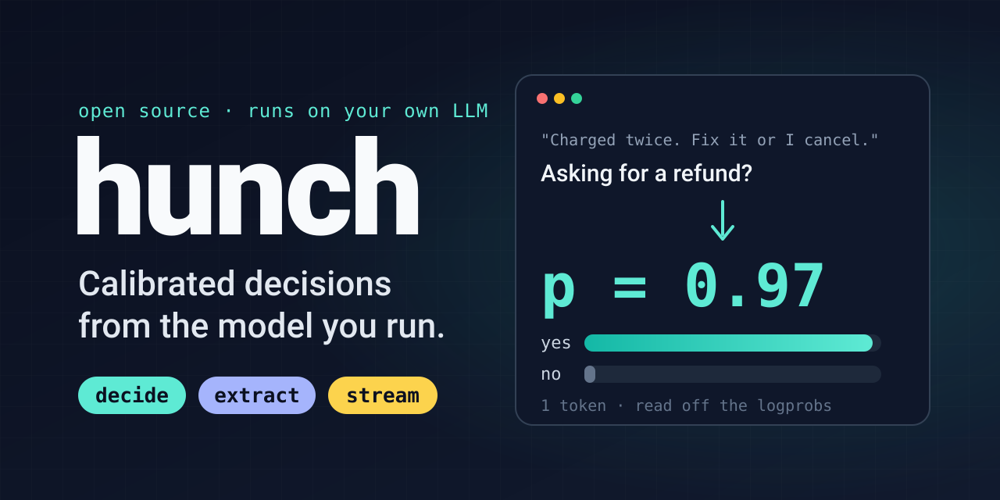

<p align="center"></p>

# Hunch

**Calibrated decisions, source-grounded extraction and streaming decisions from your own LLMs — on text and on
images — read straight off the logprobs.**

Hunch 2.0 turns the model you already run into a decision-and-extraction API: typed answers with a probability,
`null` when the model isn't sure, fields copied out of the text with the exact span they came from, and decisions
that update as a conversation grows. One output token per decision. No new model, no subscription. See
[What's new in 2.0](#whats-new-in-20).

A lot of code needs a small judgment that plain logic can't express: *is this message asking for a refund?
Which team should handle this ticket? How severe is this alert? Does this new fact replace the old one?*
The usual answer is a pile of `if/else` branches and regexes, or a chat prompt whose free-text answer you then
parse. Hunch replaces both with one typed call. You describe the check, and it returns a probability your code
can threshold, not a paragraph.

It works on photos too. *Does this photo show flooding? Does it show the event in the headline? Is this a protest or
a concert crowd?* Send the image with the check and get a probability you can gate at 0.9, the same as for text. On
188 hand-labelled look-alike photos (a flooded street vs a wet one, earthquake rubble vs a demolition site, a building
on fire vs one lit by fireworks), four vision models qualify, one of them a 4-bit 35B MoE on an edge-class GPU, with Gemma-4-31B at **98.4%** and calibration error
0.016. See [Images](#images).

- **Typed checks:** `yesno` → `p_yes`, `pick` (one of up to 300 options) → the best option and a full
  distribution, `scale` (up to 10 ordered levels) → an expected value and a distribution, `tags` (multi-label)
  and `sort` (order items by a criterion). Every result also carries a uniform `answer` and `probability`, and
  `answer` is `null` when the probability is under your `min_probability`.
- **Extraction:** `POST /v1/extract` / `hunch.extract()` pulls typed fields (text, number, money, date, time,
  duration) out of text. Each field has a probability, the character offsets it was copied from, and a status. A value
  the model wrote that is not in the source is never returned.
- **Streaming decisions:** a WebSocket (`/v1/stream`) or `hunch.astream()` session re-judges the checks as text is
  appended and tells you which answers just flipped. The prefix cache makes each update cost about the new text.
- **No text generation.** Each check is a single constrained output token (`max_tokens: 1`), and the answer
  is read from the token logprobs and renormalised over the allowed labels. The model can't ramble, and a
  malformed answer can't make it into your code.
- **Images too.** Send photos with the request and ask about them (*does this photo show flooding? does it show
  the event in the headline?*) on any vision model your vLLM serves. Same checks, same probabilities, same gate:
  four models qualify on a hand-labelled set of 188 look-alike photos (see [Images](#images)).
- **Parallel by default.** All checks in a request run concurrently, with the context first in every prompt so the
  server's prefix cache is reused.
- **Your models, your hardware.** Hunch runs against a self-hosted [vLLM](https://github.com/vllm-project/vllm) or
  `llama-server` endpoint. No data leaves your network. See [Which backends work](#which-backends-work).
- **Any chat API, too.** Hosted endpoints that give no token logprobs run in mode `sample`: each decision is a few
  short votes, and the probability is the share of votes. Coarser and costlier than one logprob read, but it works
  everywhere (see [Backends without logprobs](#backends-without-logprobs)).

## What's new in 2.0

Everything from 1.x works unchanged; 2.0 adds to the response and adds endpoints.

| | 1.x | 2.0 |
| --- | --- | --- |
| Check kinds | `yesno`, `pick`, `scale` | + `tags` (multi-label), `sort` (items by a criterion) |
| Every result | kind-specific fields | + `answer` and `probability`; `answer: null` under `min_probability` |
| Extraction | — | `POST /v1/extract`, `hunch.extract()`: typed, grounded fields with offsets and probabilities |
| Streaming | — | `WS /v1/stream`, `hunch.astream()`: re-judge as text arrives, report flips |
| Backends | vLLM-style (constrained choice + logprobs) | + any OpenAI-compatible chat API (mode `sample`) |
| Thinking | per model (`mode`) | + per request: `reasoning: off / on / auto`; `auto` thinks only when unsure (2.1) |
| MCP | `judge` | `judge`, `extract` |

The one behaviour change: zero-config discovery used to refuse an endpoint known to return no logprobs
(`api.anthropic.com`); it now uses it in mode `sample`.

## Quick start

**Inside an agent that already talks to a vLLM endpoint, there's nothing to set up.** Hunch reads the endpoint and
model the agent already uses (`ANTHROPIC_BASE_URL` / `ANTHROPIC_MODEL`, `OPENAI_BASE_URL` / `OPENAI_MODEL`, …) and runs
in-process, with no server and no config file:

```python
from hunch import judge      # pip install "hunch @ git+https://github.com/ihubanov/hunch"
r = judge({"ticket": "Charged twice for order A-104."},
          {"refund": {"kind": "yesno", "question": "Is the customer asking for money back?"}})
r["results"]["refund"]["p_yes"]
```

The same from a shell, or as a tool the agent starts itself (see [Zero-config](#zero-config-library-cli-mcp)):

```bash
python -m hunch judge '{"context": "...", "checks": {...}}'     # one call, JSON out
claude mcp add hunch -- python -m hunch mcp                       # a `judge` tool for Claude Code
```

As a shared service:

```bash
pip install .            # or: docker build -t hunch .
export HUNCH_BACKEND_URL=http://localhost:8000          # your vLLM server
export HUNCH_BACKEND_MODEL=Qwen/Qwen3.5-397B-A17B        # a model it serves
python -m hunch selftest                                  # must print SELFTEST PASSED
python -m hunch                                           # serves http://127.0.0.1:8791
```

```bash
curl -s localhost:8791/v1/judge -H 'content-type: application/json' -d '{
  "context": {"ticket": "Charged twice for order A-104. Fix it today or I cancel."},
  "checks": {
    "refund": {"kind": "yesno", "question": "Is the customer asking for money back?",
               "yes_if": "asks for a refund or reversal of a charge",
               "no_if": "anything else, including only reporting a problem"},
    "team":   {"kind": "pick", "question": "Which team handles this?",
               "options": {"billing": "charges, refunds", "technical": "bugs", "sales": "pricing"}},
    "anger":  {"kind": "scale", "question": "How angry is the customer?",
               "levels": ["calm", "annoyed", "furious"]}
  }
}'
```

```json
{
  "model": "qwen3.5",
  "results": {
    "refund": {"kind": "yesno", "p_yes": 0.5927},
    "team":   {"kind": "pick", "pick": "billing", "probs": {"billing": 0.9997, "technical": 0.0002, "sales": 0.0001}, "confidence": 0.9975},
    "anger":  {"kind": "scale", "value": 1.647, "probs": [0.0027, 0.3477, 0.6496], "confidence": 0.3963}
  },
  "usage": {"prompt_tokens": 465, "completion_tokens": 3, "backend_calls": 3}
}
```

That's a real response from Qwen3.5-397B (lightly trimmed). `p_yes` is 0.59 because the customer reports a double charge but never
explicitly asks for money back. Hunch reports that uncertainty instead of guessing, and your code decides what 0.59 means.

## Which backends work

| Backend | How Hunch runs | Status |
| --- | --- | --- |
| Self-hosted [vLLM](https://github.com/vllm-project/vllm), or llama.cpp's `llama-server` | one token, read off the logprobs, answer constrained to your options | **Proven.** The one-token benchmarks in this README ran on vLLM; `llama-server` runs in our own deployments |
| Hosted chat APIs with no token logprobs, such as Claude's API, directly or through OpenRouter | mode [`sample`](#backends-without-logprobs): a few votes per decision, probability = vote share. Chosen automatically for `api.anthropic.com`; elsewhere set `HUNCH_MODE=sample` | **Works, coarser and costlier.** Measured on Claude Haiku 5.5 via OpenRouter (below) |
| Hosted APIs that return logprobs but can't constrain the answer (OpenRouter, …) | one token with `constrained = false`: only your options' probabilities are read and renormalised; an answer outside them fails as `off_label` | **Works.** Qualified through OpenRouter (see [Hosted logprob APIs](#hosted-logprob-apis)) |

Inside a coding CLI, see [Zero-config](#zero-config-library-cli-mcp) for which settings the CLI passes on.

## Qualify your model first

Not every model makes a good Hunch backend. In our tests the older Qwen3 generation was **confidently wrong**, and
spelling out definitions made it *worse*. Check before you rely on a model:

```bash
python -m hunch qualify qwen            # one or more model names from hunch.toml (default: all)
```

It runs straight against your backend (no Hunch server needed) and uses the 240 fictional look-alike pairs that ship
with Hunch ([`hunch/lookalikes.py`](hunch/lookalikes.py)): two runs with the look-alikes named, plus one with the
bare question. That's about 720 one-token calls, roughly a minute at the default concurrency. A model is
**QUALIFIED** when:

| Criterion | Default | Why |
| --- | --- | --- |
| Backend setup | constraint enforced, logprobs returned | otherwise answers are unconstrained |
| Accuracy at `p_yes ≥ 0.9` | ≥ 90% (`--min-accuracy`) | the gate you'd actually use |
| Calibration error (ECE) | ≤ 0.15 (`--max-ece`) | a wrong answer mustn't look as certain as a right one |
| Definitions don't hurt | named ≥ question-only − 1 point (`--max-definitions-drop`) | if better-written checks make it worse, you can't fix it by writing better checks. A drop of a point or less is run-to-run noise |
| Stability | ≤ 2% of answers flip between identical runs (`--max-flip-rate`) | the same input should get the same decision |

A backend that is down is reported as **UNAVAILABLE**, not as a failed model. The exit code is 0 only if every
model qualifies, and `--json FILE` writes the full report. `--quick` does one named run (no stability check).

`python -m hunch selftest` is the 10-second version (setup plus 12 cases). Run it after every deployment. Use
`qualify` when choosing or upgrading a model.

## API

### `POST /v1/judge`

| Field | Type | |
| --- | --- | --- |
| `context` | string, object or array | The data to judge. Use an object with named fields when there are several parts, and refer to them in questions with backticks, e.g. `` `ticket.messages[0]` `` |
| `checks` | object: id → check | Your own ids; results come back under the same ids |
| `images` | list of strings, optional | Up to 8 images for a vision model: `https://…` URLs the backend can fetch, or `data:image/…;base64,…` URLs. They are part of the context, numbered `IMAGE 1`…`IMAGE n` so questions can refer to them. `context` may be omitted when only images are judged |
| `model` | string, optional | One of the configured models; defaults to `service.default_model` |
| `effort` | string, optional | Thinking effort for a `deliberate` model on this call only (`low` / `high` / `max`). Ignored for `one_token` models (it would switch thinking on) and by backends without it. In `hunch.toml`, `effort` requires `mode = "deliberate"` or `"auto"` |
| `min_probability` | number 0–1, optional | Any answer whose `probability` is below this comes back as `answer: null`. A check's own `min_probability` overrides it |
| `reasoning` | `off` / `on` / `auto`, optional | `off`: answer in one token. `on`: think first, then answer. `auto`: answer in one token and think only when needed — see [Think only when unsure](#think-only-when-unsure). Omitted: the model's configured `mode` |
| `escalate_below` | number 0–1, optional | With `reasoning: "auto"`, think on any check whose one-token `probability` is below this (default 0.9) |

Check kinds:

| `kind` | Fields | Result |
| --- | --- | --- |
| `yesno` | `question`, optional `yes_if`, `no_if` | `p_yes` (0–1) |
| `pick` | `question`, `options`: key → description or `null` (1–300 options) | `pick` (most likely key), `probs` (key → p), `confidence` |
| `scale` | `question`, `levels`: list of descriptions, lowest first (1–10) | `value` (expected level, can fall between levels), `probs` (list), `confidence` |
| `tags` | `question`, `tags`: key → description or `null` (1–50) | `tags` (keys at p ≥ 0.5), `probs` (key → p). Each tag is its own yes/no call, in parallel |
| `sort` | `question` (the criterion), `items`: list or key → item (1–100), optional `order` (`desc` default, or `asc`), optional `levels` | `order` (keys, or list indices as strings), `scores` (expected rating 0–9 per item). The model rates each item; code sorts |

Every result also has `answer` and `probability`: `yesno` → `"yes"`/`"no"` and the probability of that answer;
`pick` → the key; `scale` → the most likely level index; `tags` → the tag list, with the least certain tag's
probability. Any check may carry `min_probability`; under it `answer` is `null` and the other fields are unchanged,
so you can still see how close the call was. `sort` has no `answer`/`probability`.

### Think only when unsure

`"reasoning": "auto"` gives you one-token speed on the questions that don't need thought and a thinking model's
accuracy on the ones that do. Every check is answered in one token, and next to it, on the same cached context,
a one-token pre-check asks whether the answer can be read straight from the context or has to be worked out
(arithmetic, counting, dates, a chain of rules). The model thinks, in deliberate mode, only when the one-token
answer is under `escalate_below` (default 0.9) **or** the pre-check says it has to be worked out. Each result
says `"reasoned": true/false` (with `fast_probability` and `needs_steps` when it thought), and the response lists
the `escalated` checks.

The pre-check is what makes this safe: confidence alone misses one-pass answers that are confidently wrong on a
computed question. On the multistep set, confidence-only `auto` scored 99/100 with Qwen3.8 and 87/100 with
DeepSeek-V4.1; with the pre-check, both scored 100/100.

Measured on a mixed workload: the 240 look-alike judgments (the answer is in the text) plus the 100
[multistep decisions](#multistep-decisions-public-benchmark) (it has to be worked out), Qwen3.8-Flash-Next,
concurrency 6:

| `reasoning` | Correct (of 340) | Thought on | Output tokens / item | p50 |
| --- | --- | --- | --- | --- |
| `off` | 303 | 0 | 1 | 0.63 s |
| `on` | 338 | 340 | 170 | 1.59 s |
| **`auto`** | **338** (338 on a rerun) | 12 look-alikes + 99 multistep | **78** | **0.95 s** |

Same accuracy as always thinking, at under half the output tokens. Input tokens roughly double (the pre-check
is a second one-token call), but it shares the cached context, so on your own server it costs little.

Use `auto` only with a model whose **one-token** mode qualifies (`python -m hunch qualify`). A model whose
one-token answers are confidently wrong skips thinking exactly where it needs it: DeepSeek-V4.1-Flash, whose
one-token mode fails calibration, got 204/240 on the look-alikes with thinking off and 315/340 overall with
`auto`, against 335 with `reasoning: "on"`. For such a model, use `on` (or `mode = "deliberate"`).

### `POST /v1/extract`

```bash
curl -s localhost:8791/v1/extract -H 'content-type: application/json' -d '{
  "context": "Hi, I'"'"'d like a midsize SUV picked up at 5pm tomorrow near the airport. Budget is up to $450 a month. Add a child seat and a GPS, no colour preference.",
  "fields": {
    "vehicle":  "the vehicle asked for",
    "pickup":   {"type": "time"},
    "day":      {"type": "date"},
    "budget":   {"type": "money"},
    "colour":   "paint colour",
    "extras":   ["an extra asked for"],
    "location": "pickup place"
  },
  "now": "2026-11-03"
}'
```

A real response from Gemma-4-31B (one backend call, 280 prompt and 80 output tokens, offsets into `context`):

```json
{"results": {
  "vehicle":  {"value": "midsize SUV", "text": "midsize SUV", "start": 15, "end": 26, "probability": 1.0, "status": "found"},
  "pickup":   {"value": "17:00", "text": "5pm", "start": 40, "end": 43, "probability": 1.0, "status": "found"},
  "day":      {"value": "2026-11-04", "text": "tomorrow", "start": 44, "end": 52, "probability": 1.0, "status": "found"},
  "budget":   {"value": {"amount": 450, "currency": "USD"}, "text": "$450 a month", "start": 87, "end": 99, "probability": 0.8355, "status": "found"},
  "colour":   {"value": null, "text": null, "start": null, "end": null, "probability": 1.0, "status": "absent"},
  "extras":   {"items": [{"value": "child seat", "text": "child seat", "start": 107, "end": 117, "probability": 1.0, "status": "found"},
                         {"value": "GPS", "text": "GPS", "start": 124, "end": 127, "probability": 1.0, "status": "found"}]},
  "location": {"value": "near the airport", "text": "near the airport", "start": 53, "end": 69, "probability": 1.0, "status": "found"}
}}
```

| Field | Type | |
| --- | --- | --- |
| `context` | string (an object is read as its JSON) | The text to read. Offsets refer to it |
| `fields` | object: name → spec | `"description"`, `["description"]` (every mention, as a list), or `{"description", "type", "many", "min_probability"}` (up to 64 fields) |
| `now` | `YYYY-MM-DD`, optional | Reference date for relative dates (`tomorrow`, `next Friday`, `in two weeks`). Default: today, UTC |
| `min_probability`, `model`, `effort` | optional | As for `/v1/judge` |

How it works: the model writes one JSON object under a JSON-schema constraint (`response_format`), copying each
value **verbatim** from the context or writing `null`. Its job is copying, not interpreting. Code then:

- scores each field as the product of the probabilities of the tokens that spell its value (the closing quote
  included, so where the value ends counts too). For `null`, the probability measures how sure the model is that
  the context doesn't say;
- finds the span in the source (exact match, then case-insensitive, then any whitespace between words) and returns
  `start` / `end`. A value that can't be found is returned as `status: "ungrounded"` with `value: null`;
- parses the type from the source span: `number` (`"12k"` → 12000), `money` (`{"amount", "currency"}`; a bare `$` is
  USD), `date` (ISO; `03/04/2026` is ambiguous and stays unparsed rather than guessed), `time` (`HH:MM`), `duration`
  (seconds).

`status` is `found`, `absent`, `unsure` (under `min_probability`), `ungrounded` or `unparsed` (the span is there but
isn't a valid value of its type). Anything but `found` has `value: null`, so `if field["value"] is not None` is the
only check your code needs. The backend must support `response_format: {"type": "json_schema"}` (vLLM does);
`selftest` reports whether it does.

### `WS /v1/stream`

```text
-> {"type": "start", "checks": {...}, "emit": "changes", "min_probability": 0.8}   (model, effort, text optional)
<- {"type": "ready"}
-> {"type": "append", "text": "Hi, I'm calling about my plan. "}
<- {"type": "decision", "update": 1, "changed": ["cancel"], "results": {"cancel": {"answer": "no", ...}}, "chars": 31, ...}
-> {"type": "append", "text": "Please cancel it today."}
<- {"type": "decision", "update": 2, "changed": ["cancel"], "results": {"cancel": {"answer": "yes", ...}}, ...}
-> {"type": "end"}
```

Every update re-judges all checks on the whole text so far. With `emit: "changes"` (the default) a decision is sent
only when an answer flips, carrying just the flipped checks; `emit: "all"` sends every update in full. Appends that
arrive while a judgment is running are merged into the next one, so every decision is about the newest text and
work never piles up. Authenticate with `Authorization: Bearer …` or `?api_key=…` (browsers can't set WebSocket
headers). In Python:

```python
from hunch import astream
async with astream({"cancel": {"kind": "yesno", "question": "Does the caller want to cancel?"}}) as s:
    for chunk in transcript:
        u = await s.append(chunk)
        if "cancel" in u["changed"] and u["results"]["cancel"]["answer"] == "yes":
            route_to_retention()
```

Measured on Gemma-4-31B: a 4-turn call with one yes/no check and a 3-tag check (4 backend calls per update) took
0.6–1.1 s per update, and `cancel` flipped to `yes` on the update that said so.

`confidence` = 1 − normalised entropy of the distribution: 1.0 means all probability is on one answer, 0.0 means uniform.

Errors come back as `{"error": {"code": "...", "message": "..."}}`:

| HTTP | `code` | When |
| --- | --- | --- |
| 400 | `invalid_request`, `unknown_model`, `too_many_options`, `too_many_levels`, `too_many_images`, `too_many_fields`, `images_not_supported` (images sent to a text-only model) | Bad input (unknown fields are rejected) |
| 401 | `unauthorized` | `HUNCH_API_KEYS` is set and the bearer key is missing or wrong |
| 413 | `context_too_long` | The context plus the question exceed the model's context window |
| 502 | `backend_error` | The backend returned an error, or did **not** enforce the constraint (never turned into a made-up probability) |
| 502 | `no_label` | Mode `sample`: none of the sampled replies named an allowed answer |
| 503 | `backend_unavailable` | Still failing after retries (429 / 5xx / timeouts, with `Retry-After` honoured) |

### Hosted logprob APIs

Some hosted APIs return token logprobs but ignore `structured_outputs`, so the answer can't be forced to your
options. Set `constrained = false` for the model: Hunch then reads only your options' probabilities from the
first token's `top_logprobs` and renormalises them. If your options hold less than `min_label_mass` (default 0.5)
of the probability, the call fails with `off_label` instead of guessing. A response that comes back without
logprobs (a router can hand a call to a provider that drops them) is retried. Run `python -m hunch qualify` first.

```toml
[backend]
url = "https://openrouter.ai/api/v1"

[models.gemma]
backend_model = "google/gemma-4-31b-it"
constrained = false
[models.gemma.extra_body]
reasoning = { enabled = false }                 # one-token answers need thinking off
provider = { require_parameters = true }        # only providers that return logprobs
```

Measured through OpenRouter (full `qualify`: 240 labelled pairs, two runs and a question-only run), next to the
same models on self-hosted vLLM:

| Model | Accuracy at 0.9, OpenRouter | ECE, OpenRouter | Flips | Self-hosted accuracy / ECE |
| --- | --- | --- | --- | --- |
| Gemma-4-31B-IT | 98.8% | 0.013 | 0.0% | 98.8% / 0.013 |
| Qwen3.5-397B-A17B | 99.6% | 0.047 | 0.4% | 100.0% / 0.017 |

Both qualify. The first run found that OpenRouter occasionally answers without logprobs (1–4 calls in 720); those
calls are now retried.

### Backends without logprobs

Hosted chat APIs that return no token logprobs can't be read the usual way. Set `mode = "sample"` for the model in
`hunch.toml` (or `HUNCH_MODE=sample`; it is chosen automatically for `api.anthropic.com`). Each decision is then
asked `samples` times (default 7, `HUNCH_SAMPLES`) at `sample_temperature` (default 1.0) with no constraint, the
reply's first label is read leniently (`Y`, `Yes.`, `**B**`), and the probability is the share of votes. Extraction
runs `samples` times too, and a field's probability is the share of samples that agree on it.

Replies are read as a person would: the first word if it is a lone label (`Y`, `Yes.`, `**B**`, `C) sales`), else
a lone label on the last line, since some hosted models work the answer out in plain text first and put the
label last. `max_tokens` is `think_budget`, because hosted models may think before answering and a small cap
returns an empty reply; a direct answer still stops after one token.

The cost is real: probabilities move in 1/`samples` steps and every vote costs a full prompt (use the provider's
prompt caching). Prefer a logprob backend when you have one. vLLM-only request fields are not sent in this mode.

Measured through OpenRouter on Claude Haiku 5.5 (no logprobs), 5 votes per decision: the selftest's 12 cases
12/12 (twice), its extraction case 5/5, and [multistep_decisions](#multistep-decisions-public-benchmark)
**99/100** with ECE 0.010, at about 1,600 input and 690 output tokens per item (the model reasons in text on the
harder items) and a 1.5 s p50.

`GET /v1/models` lists the configured models, each with the `mode` its checks actually run in (`one_token` or
`deliberate`; `auto` is resolved, with the configured value in `configured_mode`). `GET /health` checks that the backend serves them.

## Why logprobs instead of asking for JSON

The common way to get a decision out of an LLM is to ask for JSON (`{"is_refund": true}`) and parse it. That works,
but you only get the model's *top* answer, with no sense of how close the call was. You pay for the output tokens,
reasoning models may think for hundreds of tokens first, and every so often the output isn't valid.

Hunch asks for exactly **one constrained token** and reads the probability the model put on each allowed answer:

| | Ask for JSON | Hunch |
| --- | --- | --- |
| What you get | one answer (`true`) | a probability (`p_yes: 0.93`) plus a distribution for picks and scales |
| Close calls | invisible: 51% and 99% look the same | visible, so you can route 0.4–0.6 to a human or a bigger model |
| Output tokens | tens to hundreds (more with thinking) | 1 |
| Malformed output | possible, needs retries or repair | impossible: the grammar only allows the labels |
| Thresholds | fixed by the model's wording | yours: act at 0.9, review at 0.5–0.9, drop below 0.5 |
| Many questions | one long prompt, and answers influence each other | independent parallel checks over the same cached context |

The probability is what makes this useful in code: you pick the threshold per decision, based on how costly a
mistake is. That's a plain `if p_yes >= 0.9`, not a prompt tweak.

## Zero-config: library, CLI, MCP

The same engine runs three more ways, all using **the LLM the agent already has** instead of a separate setup:

| | How | For |
| --- | --- | --- |
| Library | `from hunch import judge, ajudge` | Python agents and scripts: in-process, no server |
| One-shot CLI | `python -m hunch judge '<json>'` (or `-` for stdin) | shells, other languages, cron |
| MCP server | `python -m hunch mcp` (stdio, `judge` and `extract` tools) | agents that call tools: the agent starts it on demand |
| HTTP server | `python -m hunch` | a shared service; unchanged, and now also zero-config |

Settings are found in this order: arguments (`judge(..., base_url=, api_key=, model=)`), a `hunch.toml`, then the
agent's own variables. The first one set wins:

| | Variables |
| --- | --- |
| Endpoint | `HUNCH_BACKEND_URL`, `ANTHROPIC_BASE_URL`, `OPENAI_BASE_URL`, `OPENAI_API_BASE`, `LLM_BASE_URL` (a trailing `/v1` is fine) |
| Key | `HUNCH_BACKEND_KEY`, `ANTHROPIC_API_KEY`, `ANTHROPIC_AUTH_TOKEN`, `OPENAI_API_KEY`, `LLM_API_KEY`. None at all is fine |
| Model | `HUNCH_BACKEND_MODEL`, `ANTHROPIC_MODEL`, `OPENAI_MODEL`, `LLM_MODEL`; if none is set and the endpoint serves one model, that one |

- **`HUNCH_MODE` / `HUNCH_EFFORT` apply only on this discovered path.** `mode` and `effort` are per model in a
  config file, so a config file wins and Hunch prints a warning to stderr if you set the variables while one
  declares models. Set `mode` in the file there. (This is the trap that costs an hour: the variables look like
  they worked, because the same values appear in the response either way.)
- **Mode is `auto`:** one probe per model (remembered for the process) decides between one token and
  [deliberate](#deliberate-mode). It catches models with *no* thinking-off mode (GLM-5.3), but not models whose
  thinking-off answers are merely worse: DeepSeek-V4.1-Flash probes as one-token and fails `qualify` that way. For
  those, set `HUNCH_MODE=deliberate` (and `HUNCH_EFFORT=low`); `qualify` tells you which models need it.
- **Every response says how it ran:** `mode` (resolved) and `effort` (the thinking effort actually sent, `null` in
  one-token mode). A requested `effort` that was not applied adds a `notes` entry instead of being dropped silently.
  This is the only change to the HTTP response since v1.5: two added fields, and `notes` when relevant.
- **The main model, not the small one.** `ANTHROPIC_SMALL_FAST_MODEL` is deliberately not read. Run
  `python -m hunch qualify` on whatever you point it at.
- **It works best with token logprobs.** Point it at an OpenAI-compatible vLLM server (a gateway in front of one is
  fine). Anthropic's API returns no logprobs, so for `api.anthropic.com` Hunch switches to
  [`sample` mode](#backends-without-logprobs): slower, and the probability is a vote share. For one-token speed, an
  agent running on Claude itself should set `HUNCH_BACKEND_URL` to a vLLM server.
- **Inside a coding CLI, Hunch sees only the variables someone set.** Checked with Claude Code 2.1: an MCP server it
  starts inherits its environment, so `ANTHROPIC_BASE_URL` / `ANTHROPIC_MODEL` set for the CLI (as forks and
  local-model setups do) reach Hunch, and it uses the CLI's own model with no setup. A normal subscription login sets
  neither variable, and choosing a model with `--model` does not export `ANTHROPIC_MODEL`. There, name the backend:
  `claude mcp add hunch -e HUNCH_BACKEND_URL=http://your-vllm:8000/v1 -e HUNCH_BACKEND_MODEL=your-model -- python -m hunch mcp`.
- `judge()` blocks, and is safe to call from code that already runs an event loop. `ajudge()` is the async version.
  Both return the HTTP API's `{"model", "results", "usage"}` and raise `hunch.HunchError` (`.code`, `.message`).

MCP config for other clients:

```json
{"mcpServers": {"hunch": {"command": "python", "args": ["-m", "hunch", "mcp"]}}}
```

## Using it over HTTP

No client library is needed; it's one POST:

```python
import httpx

HUNCH = "http://127.0.0.1:8791"

def judge(context, checks, model=None, images=None):
    body = {"context": context, "checks": checks, "model": model}
    if images:
        body["images"] = images     # vision models: http(s) or data: URLs, see Images below
    r = httpx.post(f"{HUNCH}/v1/judge", json=body, timeout=60)
    r.raise_for_status()
    return r.json()["results"]

res = judge(
    {"old": "The staging DB listens on port 5432.", "new": "Staging DB moved to port 6432."},
    {"replaces": {"kind": "yesno",
                  "question": "Does `new` replace `old`'s value for the same thing?",
                  "yes_if": "same thing, changed value",
                  "no_if": "the same value restated, only more detail added, or a different thing"}},
)
p = res["replaces"]["p_yes"]
if p >= 0.9:
    ...        # act automatically
elif p >= 0.5:
    ...        # queue for review
else:
    ...        # leave as is
```

Patterns that work well:

- **Fan out.** Put every question you *might* need about one context in a single request. They run in parallel and
  share the cached context, so the questions your code ends up ignoring cost little.
- **Choose from candidates, don't generate.** Find candidates with code (regex, search, a list of IDs) and ask a
  `pick` which one fits. The answer is always one of your candidates.
- **Decompose.** Rather than one "how good is this?" `scale`, ask three narrow `scale`s and weight them in code.
  When your priorities change, you change a weight, not a prompt.
- **Gate expensive work.** Use a cheap `yesno` ("does this passage answer the question at all?") before sending
  anything to a big generative model.

## Images

Hunch passes images through to the model as ordinary chat content parts, so any vision model on your vLLM server
can answer checks about photos, and the answer is read off the logprobs exactly as for text:

```python
res = judge({"headline": "Floods hit the area"},
            {"shows_it": {"kind": "yesno", "question": "Does the photo show the event described in the headline?",
                          "yes_if": "the photo shows that kind of event",
                          "no_if": "a similar-looking but different scene (e.g. a wet street for a flood), "
                                   "or a real photo of a different kind of event"}},
            images=["data:image/jpeg;base64,..."])
```

**Measured.** [`bench/images.py`](bench/images.py) runs 188 freely licensed Wikimedia Commons photos, labelled by
hand, through eight questions a news or monitoring pipeline asks. Each question comes with its look-alike: a
flooded street vs a wet one (and photos of London's *Flood Street*), a protest vs a concert crowd or a memorial, an
active wildfire vs a red sunset or forest that has already burned, a road crash vs a traffic jam, a building on
fire vs one lit red by fireworks or a fire station, earthquake rubble vs a demolition site, a polling station vs a
queue, a press conference vs a lecture or TED talk. Scored with `qualify`'s criteria, NVFP4 checkpoints on vLLM,
thinking off, one token per check:

| Model | *"Does this photo show …?"* | AUROC | ECE | *"Does the photo show the event in the headline?"* | AUROC | ECE | Flips |
| --- | --- | --- | --- | --- | --- | --- | --- |
| Gemma-4-31B-IT | ✅ **98.4%** | 1.000 | 0.016 | ✅ **98.2%** | 0.997 | 0.016 | 0% |
| Qwen3.5-397B-A17B | ✅ 97.3% | 0.999 | **0.013** | ✅ 97.4% | 0.997 | 0.055 | 0% |
| Qwen3.8-Flash-Next | ✅ 97.3% | 1.000 | 0.021 | ✅ 96.7% | 0.998 | 0.022 | 0–0.4% |
| Qwen3.6-35B-A3B (AWQ int4, edge-class GPU) | ✅ 97.9% | 1.000 | 0.072 | ✅ **98.2%** | 0.999 | 0.085 | 0–0.4% |

Accuracy is at the `p_yes ≥ 0.9` gate over 188 photos (photo task) and 274 checks (headline task: every photo with
its own event's headline, plus every real event photo with a clearly different event's headline, all of which the
three models rejected). For both Qwen models the definitions cost 0.4 points on the headline task (one check in
274), within the 1-point allowance.

**What this shows:** the 0.9 gate carries over to images unchanged. Calibration on photos is as good as or better
than on text, and the few remaining misses are photos the models hedge on (a tree standing in Mekong floodwater, a
car hanging off a quay), which is what a gate should send to review.

**Limits:** eight questions and 188 photos, chosen and labelled by us; well-known Commons photos may be in the
models' training data; no stock-photo or AI-generated-image detection was tested. Two lessons from building it:
auditing labels against the models' disagreements found one of ours wrong (a car-and-streetcar collision we had
labelled "no crash"), and headlines that name details ("thousands march demanding new elections") make most real
protest photos a correct *no*, so say in the check whether you mean the kind of event or this specific one.
**Measure on your own images** before relying on it: `python bench/images.py` shows how.

## Choosing a model

From the bundled benchmark (see [Measured](#measured)):

- **Most accurate:** a large instruct model (Qwen3.5-397B: 100%). Use it for decisions where errors are costly.
- **Best mid-size:** Qwen3.8-27B (99.6%, calibration error 0.058). It qualifies comfortably on a single GPU.
- **Why not a small purpose-trained decision model?** We measured one (Laya, 322M-421M, Apache-2.0).
  Asked in a form it can answer, its best checkpoint ranks these pairs at AUROC 0.953 — comparable to a
  9B LLM, in a model 20x smaller and ~2.3x faster per call — but reaches only 81.2% at the 0.9 gate with
  ECE 0.301, i.e. a good ordering with probabilities you would have to calibrate yourself. Method,
  numbers, and two corrections we published against ourselves:
  [docs/COMPARISON-laya.md](docs/COMPARISON-laya.md).
- **Generation beats size.** Every Qwen3-generation model failed (Qwen3-14B scored *below* Qwen3-8B), while the newer
  Qwen3.5+ models pass. The small Qwen3.5-9B ranks almost perfectly (AUROC 0.996) but hedges on look-alikes, so use it
  only with a strict act threshold (≥ 0.97) and human review below that.
- **Best calibrated per GPU:** a mid-size dense model (Gemma-4-31B: 98.8%, calibration error 0.013). Its
  probabilities are the most trustworthy as probabilities, and it's light enough to run next to other workloads.
- **Edge:** a small MoE (Qwen3.6-35B-A3B, 4-bit: 99.6%). It fits on edge hardware and
  suits requests that ask only a few checks.
- **A thinking-off mode is not automatically a good one.** DeepSeek-V4.1-Flash answers in one token, but those answers
  follow the order the options are listed in, and even with `debias = true` its calibration fails (ECE 0.192).
  Allowed to think for ~60 tokens (`mode = "deliberate"`, `effort = "low"`) it qualifies at 98.8% with ECE 0.013, tied
  with Gemma as the best calibrated model we have measured. See
  [Models whose thinking-off mode is weaker](#models-whose-thinking-off-mode-is-weaker).
- **Position-biased models** work with `debias = true`, at twice the calls. It reduces the bias by averaging it; it
  does not remove it.
- **Check the model has a real non-thinking mode.** GLM-5.3 has none: its template always opens a thinking block, so
  its first token is never an answer. Run it with `mode = "deliberate"` and it qualifies at 97.5% (ECE 0.025); leave
  it in one-token mode and it scores 66.7% (see [Models with no non-thinking mode](#models-with-no-non-thinking-mode)). Run `python -m hunch selftest` and `python bench/bench.py accuracy <model>` before adopting a model.
- **Thinking models must have thinking switched off per request.** Otherwise the one allowed token is spent on
  reasoning. Hunch sends `reasoning_effort: "none"` by default. Some chat templates need
  `chat_template_kwargs = { enable_thinking = false }` in the model's `extra_body` instead (see `hunch.toml.example`).

## When not to use Hunch

- **Generating text** (summaries, replies, rewriting). Use a generative model. Extracting values that are *in*
  the text is what `/v1/extract` is for; values that have to be composed are not.
- **Arithmetic, counting, date comparison, exact matching.** Do it in code.
- **Multi-step reasoning.** A check is a snap judgment over the context you give it. Split the problem, or use a
  reasoning model.
- **Security boundaries.** Context is data, but a model can still be steered by adversarial text inside it. Don't make
  a Hunch check the only thing standing between untrusted input and a dangerous action.

## How it works

1. **Labels, not text.** Answers map to single-token labels: `Y`/`N`, letters `A`… for options, and digits `0`–`9`
   for levels. Each check is sent as a chat completion with
   `structured_outputs: {"choice": [labels]}`, `logprobs: true`, `max_tokens: 1`, `temperature: 0` and
   `reasoning_effort: "none"`.
2. **Probabilities from logprobs.** The label logprobs are exponentiated and renormalised over the allowed labels.
   `scale.value` is the expectation Σ i·p(i).
3. **Big picks.** vLLM returns at most `--max-logprobs` alternatives (20 by default), so a pick with more than 15
   options is split into groups. One call picks the group and one call per group picks within it, all in parallel:
   p(option) = p(group) × p(option | group). 300 options take 21 calls, 100 options take 8.
4. **Position-bias correction** (`debias = true` per model). Some models lean toward whichever answer is listed
   first. With debias on, yes/no checks are asked in both answer orders and small picks in both option orders, and
   the results are averaged. That doubles the calls, so only enable it for models that need it.

**vLLM gotcha:** use `structured_outputs`. Some vLLM versions silently **ignore** the legacy `guided_choice`
parameter, so the model answers unconstrained and nothing tells you. `python -m hunch selftest` checks that the
constraint is really enforced (it asks the model to write "hello" while restricted to `A`/`B`).

## Measured

Hunch ships 240 **fictional, labelled look-alike pairs** ([`hunch/lookalikes.py`](hunch/lookalikes.py)): "does NEW replace OLD?" and
"do A and B say the same thing?". It deliberately includes restatements and same-value-different-thing traps,
two runs per model, with yes counted at `p_yes ≥ 0.9`. All results below use the checks in
[`hunch/lookalikes.py`](hunch/lookalikes.py), which **name the look-alike cases** in `no_if` (e.g. *"`new` restates the same
value, or is about a different thing"*). Results on vLLM (NVFP4 checkpoints unless noted), measured 2026-09:

| Model | Verdict | Accuracy | AUROC | Brier | ECE | Max drift between runs |
| --- | --- | --- | --- | --- | --- | --- |
| Qwen3.5-397B-A17B | ✅ Qualified | **100.0** | 1.000 | 0.017 | 0.049 | 0.150 |
| Qwen3.8-27B (bf16) | ✅ Qualified | 99.6 | 1.000 | 0.030 | 0.058 | – (0 flips) |
| Qwen3.6-35B-A3B (AWQ int4) | ✅ Qualified* | 99.6 | 1.000 | 0.055 | 0.116 | 0.263 |
| Gemma-4-31B-IT | ✅ Qualified | 98.8 | 0.991 | **0.013** | **0.013** | **0.011** |
| DeepSeek-V4.1-Flash (`mode = "deliberate"`, `effort = "low"`) | ✅ Qualified | 98.8 | 0.991 | **0.013** | **0.013** | – (1.2% flips) |
| DeepSeek-V4.1-Flash (one token, debias on) | ❌ Not qualified | 92.9 | 0.994 | 0.133 | 0.192 | – (1.2% flips) |
| Qwen3.5-9B (bf16) | ❌ Not qualified | 90.8 | 0.996 | 0.192 | 0.266 | – (0 flips) |
| Qwen3-8B (bf16) | ❌ Not qualified | 76.7 | 0.838 | 0.238 | 0.242 | 0.169 |
| Qwen3-14B (bf16) | ❌ Not qualified | 71.7 | 0.806 | 0.286 | 0.289 | 0.195 |
| GLM-5.3 (`mode = "deliberate"`) | ✅ Qualified | 97.5 | 0.977 | 0.025 | 0.025 | – (0.8% flips) |
| GLM-5.3 (`mode = "one_token"`) | ❌ Not qualified | 66.7 | 0.734 | 0.194 | 0.065 | – (9.2% flips) |
| Qwen3-0.6B (bf16) | ❌ Not qualified | 35.8 | 0.758 | 0.611 | 0.630 | 0.024 |

Verdicts use `python -m hunch qualify`'s default criteria (accuracy ≥ 90%, ECE ≤ 0.15, definitions cost at most 1 point,
≤ 2% flips). Qwen3.5-397B, Qwen3.8-27B, Gemma-4-31B, Qwen3.5-9B, GLM-5.3 and DeepSeek-V4.1-Flash were run through `qualify` itself; for the others the
same criteria are applied to their benchmark numbers. \* Qwen3.6-35B-A3B passes on accuracy, calibration and stability;
its question-only run wasn't measured.

Why the others fail:
- **DeepSeek-V4.1-Flash in one-token mode:** calibration. Its thinking-off answers lean on the listed order of the
  answers; allowed to think, the same model qualifies. See
  [Models whose thinking-off mode is weaker](#models-whose-thinking-off-mode-is-weaker).
- **Qwen3.5-9B:** calibration. Real positives sit at p≈0.99, but the look-alike traps land at a median of 0.42–0.65, so
  it hedges rather than being confidently wrong.
- **The Qwen3 generation:** confidently wrong, and definitions make it *worse*.
- **GLM-5.3 in one-token mode:** it has no non-thinking mode, so its first token opens a scratchpad rather than
  answering. In `mode = "deliberate"` the same model qualifies at 97.5% with ECE 0.025. See
  [Models with no non-thinking mode](#models-with-no-non-thinking-mode).

### Multistep decisions (public benchmark)

[multistep_decisions](https://github.com/levantolabs/multistep_decisions) (MIT, v1.0, data sha256 `c4574401…`)
is 100 typed decisions whose answer is not written in the text: it has to be constructed (a total carried across
stock movements, a rule chain with a buried exception, business hours across time zones). It was built to show
that a one-pass decision model has no scratchpad for that. Run with [`bench/multistep.py`](bench/multistep.py),
scored with the benchmark's own `evaluate.py`, 2026-11-03, concurrency 4 against a shared vLLM server:

| Model (NVFP4) | Mode | Correct | ECE | Brier | Output tokens / item | p50 |
| --- | --- | --- | --- | --- | --- | --- |
| DeepSeek-V4.1-Flash | deliberate | **100 / 100** (100 on a rerun) | 0.000 | 0.000 | 132 (119 on the rerun) | 1.7 s |
| Qwen3.8-Flash-Next | deliberate | **100 / 100** (100 on a rerun) | 0.066 | 0.011 | 227 (225) | 2.4 s |
| Gemma-4-31B | one_token | 74 / 100 | 0.242 | 0.495 | 1 | 0.65 s |
| Qwen3.8-Flash-Next | one_token | 65 / 100 | 0.068 | 0.430 | 1 | 0.66 s |
| Uniform random over the labels | | 35.8 (expected) | | | | |

The split is the point: a one-token answer is the right tool for a judgment that is *in* the text, and the wrong
one for an answer that has to be worked out. `mode = "deliberate"` lets the model think briefly, constrains only its
final verdict token, and still returns a probability. The set was published on 2026-09-22 and we can't rule out
that a model saw its items, so read the deliberate scores as "these models reach these answers", not as a
contamination-free measurement.

### Same benchmark, vague checks

The same 240 pairs with only the `question` ("Does `new` replace `old`'s value for the SAME thing?"), with no `yes_if` /
`no_if` (`python bench/bench.py accuracy --vague <model>`). A dash means the row came from `python -m hunch qualify`,
which until v1.2.1 recorded only accuracy for its question-only run; those backends are no longer up to re-measure.

| Model | Verdict | Accuracy, look-alikes named | Accuracy, question only | AUROC, question only | Brier, question only |
| --- | --- | --- | --- | --- | --- |
| Qwen3.5-397B-A17B | ✅ Qualified | 100.0 | **83.3** | 0.884 | 0.182 |
| Qwen3.8-27B | ✅ Qualified | 99.6 | **80.0** | – | – |
| GLM-5.3 (`mode = "deliberate"`) | ✅ Qualified | 97.5 | **81.2** | – | – |
| Gemma-4-31B-IT | ✅ Qualified | 98.8 | **80.4** | 0.863 | 0.196 |
| DeepSeek-V4.1-Flash (`mode = "deliberate"`, `effort = "low"`) | ✅ Qualified | 98.8 | **83.3** | 0.875 | 0.167 |
| DeepSeek-V4.1-Flash (one token, debias on) | ❌ Not qualified | 92.9 | **78.3** | 0.865 | 0.241 |
| Qwen3.5-9B | ❌ Not qualified | 90.8 | **81.7** | – | – |
| Qwen3-8B | ❌ Not qualified | 76.7 | **81.2** (definitions hurt) | – | – |
| Qwen3-14B | ❌ Not qualified | 71.7 | **74.6** (definitions hurt) | – | – |
| GLM-5.3 (`mode = "one_token"`) | ❌ Not qualified | 66.7 | **67.5** (definitions hurt) | – | – |

The model and the service are the same; only the definitions changed. On every model that can answer the question at
all, two short definitions (`yes_if` / `no_if`) are worth 9–24 accuracy points. Definitions go the other way on the
older Qwen3 models, and on GLM-5.3 in one-token mode — where nothing in the prompt can help, because the token being
read is not an answer. The same GLM in `deliberate` mode gains 16 points from them. That contrast is exactly what
`qualify`'s "definitions help" check is for. Write the definitions first, then choose the model.

These are results for one synthetic task on our hardware. **Measure on your own labelled cases** before a decision depends on
Hunch: `python bench/bench.py accuracy <model>` shows how.

### Models with no non-thinking mode

GLM-5.3 scores 66.7% here, which looks like a weak model. It isn't — we were measuring the wrong thing.

**GLM-5.3 has no non-thinking mode.** Its chat template always appends a thinking block to the generation prompt, so
the first generated token is the model *opening a scratchpad*, never an answer. Constraining that position to `Y`/`N`
projects a distribution that isn't about the verdict onto two tokens. The result looks exactly like what we measured:
probabilities pinned near 0.5, unstable between identical runs (52 of 240 answers flipped), and very sensitive to how
the prompt is built. There is no flag that avoids this: the GLM-4.x thinking toggle was removed, and
`reasoning_effort: "none"` is not a recognised value — it falls through to *maximum* reasoning while also switching
the server's reasoning parser off.

Let the same model think, and constrain only its final verdict token, and it is excellent:

| How GLM-5.3 is asked | Accuracy | AUROC | ECE | Flips | Verdict |
| --- | --- | --- | --- | --- | --- |
| One constrained token (`mode = "one_token"`) | 66.7% | 0.734 | 0.065 | 9.2% | ❌ |
| Thinking first, verdict token constrained (`mode = "deliberate"`) | **97.5%** | **0.977** | **0.025** | 0.8% | ✅ |

Same model, same server, same 240 pairs. It costs hundreds of thinking tokens and seconds per decision instead of
one token in well under a second — and with a 512-token budget a few checks never reach a verdict, so
`think_budget = 1024` is the setting that qualified.

**What to take from this:**

- **Hunch measures something narrow:** does the model have an answer *at the first generated token*? A model whose
  template always starts with a scratchpad cannot, whatever its ability.
- **The symptom is recognisable.** Probabilities clustered near 0.5, unstable between identical runs and moving a lot
  when you reshape the prompt, mean you are reading a position that isn't the answer — not that the model is weak.
  Check whether your model has a real non-thinking mode before blaming it.
- **A reasoning model can still give you a calibrated probability.** Let it think, constrain the final answer to your
  labels, and read the logprobs of that token. That is what [`mode = "deliberate"`](#deliberate-mode) does.

### Models whose thinking-off mode is weaker

DeepSeek-V4.1-Flash is the opposite case to GLM. It *does* have a working non-thinking mode: with
`reasoning_effort: "none"` its first token is a clean `Y` or `N`. But that snap answer is not the model's best
judgment:

| How DeepSeek-V4.1-Flash is asked | Accuracy | AUROC | ECE | Flips | Verdict |
| --- | --- | --- | --- | --- | --- |
| One token | 82.9% | 0.968 | 0.225 | 2.5% | ❌ |
| One token, `debias = true` | 92.9% | 0.994 | 0.192 | 1.2% | ❌ calibration |
| `mode = "deliberate"`, default effort | 97.9% | 0.984 | 0.021 | 0.8% | ✅ |
| `mode = "deliberate"`, `effort = "low"` | **98.8%** | **0.991** | **0.013** | 1.2% | ✅ |

Every error in one-token mode was a false *yes*, and most were the restatement trap, answered with confidence:
asked whether "Port 5432 is where the staging Postgres accepts connections" *replaces* "The staging Postgres listens on
port 5432", it said yes at 0.99 when `Y` was listed first, and mostly no when `N` was. `debias` averages the two
orders, which dilutes that bias into hedged probabilities but cannot remove it — hence good ranking (AUROC 0.994) and
failed calibration. Allowed to think, it gets the same pair right in both orders, spending ~60 thinking tokens (about a
second per check on our deployment), and `low` effort is enough.

**What to take from this:** when a model can think, its thinking-off answers may be the weaker of the two, and
`debias` can hide that rather than fix it. `python -m hunch qualify` now tries both (see below).

### Deliberate mode

For exactly these models, Hunch can read the answer differently. Set `mode` on the model in `hunch.toml`:

| `mode` | What happens | Cost per check |
| --- | --- | --- |
| `one_token` (default) | The answer is the first generated token | 1 token, well under a second |
| `deliberate` | The model thinks; only its final verdict token is constrained, and that token's logprobs give the probability | up to `think_budget` tokens (2048 by default) and seconds |
| `auto` | One unconstrained probe at first use: if the first token opens a scratchpad, `deliberate`, else `one_token` | one extra call, once |

Everything downstream is identical — same API, same `probs` and `confidence`, same thresholds, same `qualify`
criteria. In `deliberate` mode Hunch drops the fields that switch thinking *off* (`reasoning_effort: "none"`,
`enable_thinking: false`, `thinking: false`) but keeps real effort levels.

**How long it thinks: `effort`.** On backends that support it (GLM-style `reasoning_effort`), set `effort` per model
in `hunch.toml`, or per request for one call. More thinking buys stability, and the curve is steep at the cheap end —
GLM-5.3 on the 240 pairs:

| `effort` | Thinking tokens | Accuracy | ECE | Flips between runs | Qualifies |
| --- | --- | --- | --- | --- | --- |
| `low` | ~3 | 94.2% | 0.088 | 4.6% | no (stability) |
| `high` | ~20 | 96.7% | 0.033 | 2.5% | no (just over) |
| default (`max`) | ~79 | **97.5%** | **0.025** | **0.8%** | **yes** |

`low` costs barely more than one-token mode, which suits cheap high-volume checks where you re-run or review the
borderline cases; the default is what belongs behind a 0.9 gate. Measure it on your own task.

**Size the caller's timeout above the thinking, not Hunch's.** Hunch's own backend timeout (`timeout_s`, 30s by
default) is rarely the one that bites: a caller with an 8-second budget gives up first and gets nothing back,
usually fail-open. Measured here on DeepSeek-V4.1-Flash in deliberate mode: ~62 thinking tokens, ~1.5s per check.
GLM-5.3's untamed tail reaches 3579 thinking tokens, so budget seconds, not milliseconds. Size it above the
**p99 of your own checks, not the median** — a 2.4s median with a 16s tail (we saw one) still fails the call that
lands in the tail, and that looks like a flaky judge rather than a tight budget.
Two things to know when a call is slower than that: **some backends ignore `reasoning_effort` entirely** (on our
gateway DeepSeek thought ~62 tokens at `low`, default and `high` alike — identical latency), so if a check takes far
longer than its thinking tokens suggest, suspect queueing on a shared endpoint or a larger context, not the effort
setting; and check `effort` in the response, which reports what was actually sent.

**`think_budget` is a cap, not a knob.** Raising it does not make the model think longer, and lowering it does not
make it think less — it only decides whether a long answer arrives or the call raises. Measured on GLM at default
effort: median 128 thinking tokens, p95 671, max 3579, so a 512 cap truncated 3% of checks. With `effort` set the
tail collapses (`low` max 59, `high` max 138) and 256 is plenty. Size it above your p99 and control cost with
`effort`.

`python -m hunch qualify` handles both situations by itself. If a model fails in one-token mode **and** it can think —
either because its first token always opens a scratchpad (GLM) or because it thinks once thinking isn't switched off
(DeepSeek) — it re-runs the model in `deliberate` mode, reports both, and tells you which setting qualifies. A model
counts as qualified if either mode passes.

## Writing good checks

- **Name the look-alike.** Say what counts as *no* for the case that looks most like *yes*. On the bundled
  benchmark, dropping `yes_if` / `no_if` costs 17–24 accuracy points on every model tested
  (see [vague checks](#same-benchmark-vague-checks)). One sentence in `no_if` ("restating the same value, or a
  different thing") is most of the fix. Look for more than one look-alike: on memory-style pairs, a "replaces" or
  "duplicate" check that doesn't also say *adding detail is not a replacement (or a duplicate)* called refinements
  ("machine parts" → "machine parts, mostly pumps and valves") replacements at p = 1.0 on one model. A threshold
  can't catch that; naming the case fixes it.
- **Definitions go in `yes_if` / `no_if` and option descriptions,** not only in the question.
- **One judgment per check.** Split "is this a good candidate?" into several checks and combine them in code.
- **Keep arithmetic, counting, dates and IDs in code.** Give the model only the judgment.
- **Add an escape option** (`"none": "none of the above"`) to picks when nothing may fit. A pick always
  returns *something*.
- **Treat `p_yes` and `confidence` as uncalibrated for your task** until you've checked them against 20–40
  labelled cases.

## Framing-invariance: catch a leading check

A yes/no answer can be driven by how the question is *worded* rather than by the facts — a check phrased to expect
`yes` can inflict `yes`. `debias` already flips the label order; `judge_framed` flips the question **framing**. Give a
check a `framings` list — alternate phrasings of the same question, each tagged `"polarity": "same"` (a reword) or
`"flip"` (the complement, e.g. *"is X irrelevant?"*) — and every framing is judged in the one request and folded onto
a single *P(true)* axis:

```python
from hunch import judge_framed
r = judge_framed("Fix the error-handling in the request path.", {
    "relevant": {"kind": "yesno",
                 "question": "Is this note relevant to the task?",
                 "framings": [{"question": "Is this note irrelevant / unrelated to the task?",
                               "polarity": "flip"}]}})
r["results"]["relevant"]   # {"p_yes": ..., "swing": ..., "framing_flag": ..., "views": {...}}
```

`p_yes` is the consensus (mean of the framings' *P(true)* — the robust estimate to threshold); `swing` is the spread
between framings; `framing_flag` is `True` when `swing` exceeds `swing_gate` (default `0.25`), i.e. the wording, not
the content, is moving the answer — trust that `p_yes` less, or neutralise the question. Checks with no `framings`
pass through `judge_framed` exactly as `judge` returns them, so it is a drop-in you turn on per check.

It catches *framing*-driven answers. It does **not** catch a model that is stably wrong under every framing — that is
the model believing the wrong thing, and it needs evidence or grounding, not this.

## Configuration

`hunch.toml` (path in `HUNCH_CONFIG`, or `./hunch.toml`). See [`hunch.toml.example`](hunch.toml.example):

```toml
[backend]
url = "http://localhost:8000"

[service]
default_model = "qwen"
max_concurrency = 16        # simultaneous backend calls
# api_keys = ["change-me"]  # required when listening beyond localhost

[models.qwen]
backend_model = "Qwen/Qwen3.5-397B-A17B"

[models.deepseek]
backend_model = "deepseek-ai/DeepSeek-V4.1-Flash"
mode = "deliberate"         # its thinking-off answers are position-biased; thinking briefly fixes that
effort = "low"
```

| Environment variable | Meaning |
| --- | --- |
| `HUNCH_HOST` / `HUNCH_PORT` | Listen address (default `127.0.0.1:8791`) |
| `HUNCH_BACKEND_URL`, `HUNCH_BACKEND_KEY` | vLLM server and optional bearer key |
| `HUNCH_BACKEND_MODEL` | Quick single-model setup without a TOML file (exposed as `default`) |
| `HUNCH_DEFAULT_MODEL` | Overrides `service.default_model` |
| `HUNCH_CONCURRENCY` | Simultaneous backend calls. Keep it modest on a shared server |
| `HUNCH_BACKEND_MODEL` + `mode` in `hunch.toml` | `one_token` (default), `deliberate`, `auto` — see [Deliberate mode](#deliberate-mode) — or `sample` (no logprobs; see [Backends without logprobs](#backends-without-logprobs)) |
| `HUNCH_SAMPLES` | Votes per decision in mode `sample` (default 7), for a discovered model |
| `HUNCH_MODE`, `HUNCH_EFFORT` | Override `mode` / `effort` for a model **discovered from the environment**. Ignored (with a warning) when a config file declares models — set them in the file instead |
| `SSL_CERT_FILE` | CA bundle for a backend behind a private or self-signed CA, e.g. `/etc/ssl/certs/ca-certificates.crt` (Python doesn't use the system store by default) |
| `HUNCH_API_KEYS` | Comma-separated bearer keys. Hunch **refuses** to listen beyond localhost without them (or `HUNCH_ALLOW_NOAUTH=1` behind an authenticating proxy) |

## Deploying

- **Docker:** `docker build -t hunch .`, then run it with `HUNCH_BACKEND_URL`, `HUNCH_API_KEYS` and a mounted `hunch.toml`
  (see [`deploy/docker-compose.yml`](deploy/docker-compose.yml)). The image runs as non-root under `tini`, with a health check.
- **systemd:** [`deploy/hunch.service`](deploy/hunch.service).
- After deploying, run `python -m hunch selftest` (or `docker compose exec hunch python -m hunch selftest`).

## For coding agents

[`SKILL.md`](SKILL.md) is a drop-in guide for an agent writing a Hunch integration: the call, the rules for writing
checks, thresholds, qualifying a model, and what not to do. [`llms.txt`](llms.txt) indexes it for agents that look for
one. Point your agent at the raw URLs:

```
https://raw.githubusercontent.com/ihubanov/hunch/main/llms.txt
https://raw.githubusercontent.com/ihubanov/hunch/main/SKILL.md
```

## Development

```bash
pip install -e '.[dev]'
pytest -q                                   # offline tests against a fake backend
python -m hunch selftest                    # quick live pre-flight against your backend
python -m hunch qualify qwen                 # full qualification of a model (verdict + reasons)
python bench/bench.py accuracy qwen gemma   # live accuracy benchmark
python bench/bench.py fanout qwen           # latency vs number of checks
python bench/multistep.py DATA --model M    # the public multistep_decisions benchmark
```

## License

MIT. See [LICENSE](LICENSE).
